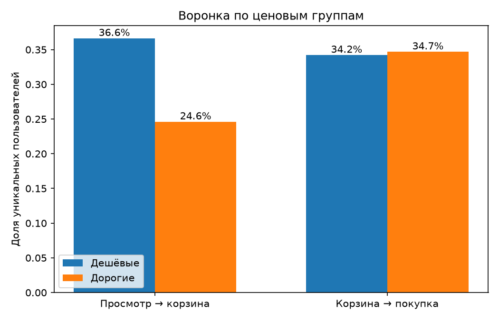
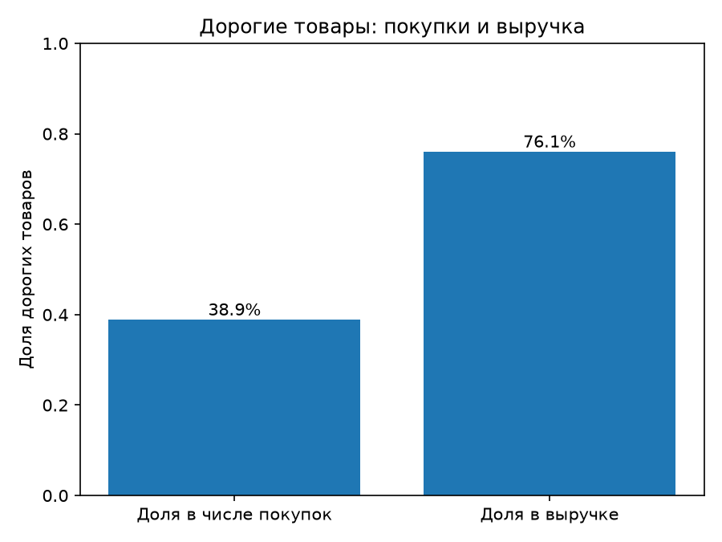

# Воронка интернет-магазина косметики: дешёвые и дорогие товары

Учебный аналитический кейс на данных о поведении пользователей интернет-магазина за декабрь 2019 года.

## Бизнес-вопрос

> Магазин думает, стоит ли в декабре смещать акцент на более дорогие товары. Одинаково ли ведут себя покупатели дешёвых и дорогих товаров на пути от просмотра до покупки, и какая группа приносит больше денег?

## Данные

- Источник: Kaggle, [eCommerce Events History in Cosmetics Shop](https://www.kaggle.com/datasets/mkechinov/ecommerce-events-history-in-cosmetics-shop), файл `2019-Dec.csv`.
- 3 533 286 событий: просмотры (`view`, 1 728 331), добавления в корзину (`cart`, 927 124), удаления из корзины (`remove_from_cart`, 664 655), покупки (`purchase`, 213 176).
- Ключевые колонки: `event_type`, `price`, `user_id`, `user_session`, `product_id`, `brand`.
- Сам файл в репозиторий не загружен из-за размера, скачайте его по ссылке выше.

## Инструменты

Python (pandas, matplotlib).

## Как делал

**1. Проверка данных.** Пропуски есть в `category_code` (около 98% строк) и `brand` (около 43%), поэтому анализ по категориям не делал. В `user_session` пропущено 779 строк (0,02%), в ключевых для воронки колонках пропусков нет.

**2. Аномальные цены.**
- 7 589 строк с нулевой ценой. Покупок среди них нет, значит, это не реальные цены.
- 18 строк с отрицательной ценой. Все это события `purchase` (сверка: покупки в ценовых группах плюс эти 18 дают ровно все 213 176 покупок). Вероятно, это возвраты или корректировки, но данные подтвердить это не могут.
- Все 7 607 строк (0,2%) исключил из анализа по ценовым группам.

**3. Деление на дешёвые и дорогие.** По медиане цены (4,22). Медиана, а не среднее: среднее (8,89) почти вдвое выше медианы из-за длинного хвоста дорогих товаров. Ниже медианы — «дешёвые», от медианы и выше — «дорогие».

**4. Воронка считается по уникальным пользователям, а не по событиям.** Один человек делает много просмотров и добавлений в корзину, поэтому по событиям конверсия получается искажённой (например, 0,536 против 0,233 для шага «просмотр → корзина»). Конверсия шага = число уникальных пользователей на шаге / число уникальных пользователей на предыдущем шаге.

**5. Выручка** считается только по событиям `purchase` как сумма `price`. Средний чек считается на один товар, а не на заказ.

## Результаты

Общая воронка за месяц (уникальные пользователи):

| Просмотр | Корзина | Покупка | Просмотр → корзина | Корзина → покупка |
|---:|---:|---:|---:|---:|
| 358 212 | 83 458 | 25 613 | 23,3% | 30,7% |

Воронка по ценовым группам:

| Группа | Просмотр → корзина | Корзина → покупка |
|---|---:|---:|
| Дешёвые | 36,6% | 34,2% |
| Дорогие | 24,6% | 34,7% |

Выручка по ценовым группам:

| Группа | Выручка | Покупок | Средний чек (на товар) |
|---|---:|---:|---:|
| Дешёвые | 257 773 | 130 162 | 1,98 |
| Дорогие | 820 391 | 82 996 | 9,88 |

Дорогие товары дают около 76% выручки при примерно 39% покупок.




## Выводы

- Дорогие товары основной источник денег: около 76% выручки при примерно 39% покупок. Выручка за счёт размера чека (9,88 против 1,98, примерно в 5 раз), а не числа покупок.
- Различие в воронке только на первом шаге: у дорогих товаров в корзину кладут заметно реже (24,6% против 36,6%). После корзины люди покупают одинаково (34,7% против 34,2%).
- Значит, потеря у дорогих товаров происходит до корзины, на этапе решения «брать или нет», а не на оплате.

## Гипотезы (не проверены)

Почему люди смотрят дорогой товар и не кладут его в корзину:

1. Цена выше ожиданий. Проверяется на этих же данных: падает ли доля корзин плавно с ростом цены или есть резкий порог.
2. Нашли аналог на другом сайте. По этим данным не проверить, нужен анализ цен конкурентов или опрос.
3. Внешний вид карточки не оправдывает цену. Проверяется экспериментом: поменять фото у части дорогих товаров и сравнить долю корзин в тестовой и контрольной группах.

## Ограничения

- Данные за один месяц (декабрь, предновогодний сезон), поведение в другие месяцы может отличаться.
- Порог между дешёвыми и дорогими условный (медиана). Группа «дорогие» неоднородна: в неё попадают и товары за 4,22, и за 300+.
- Пользователи, которые смотрели товары из обеих групп, учтены в обеих.
- Конверсия шага считается как отношение числа уникальных пользователей на соседних шагах, а не доля одних и тех же людей: часть покупателей могла не иметь события `cart` в этом месяце.
- Средний чек посчитан на товар, а не на заказ.
- Единицы цены в данных не уточнялись.
- Анализ по категориям не делал из-за пропусков в `category_code`.

## Что проверил бы дальше

- Как меняется доля корзин по мере роста цены (гипотеза 1).
- Воронку по неделям декабря и по брендам.
- Что происходит с брошенными корзинами и событиями `remove_from_cart`.
- Эксперимент с карточками дорогих товаров (гипотеза 3).

## Как запустить

```bash
pip install -r requirements.txt
# положите 2019-Dec.csv рядом со скриптом
python analysis.py
```

Скрипт печатает все цифры из этого README и сохраняет графики в папку `images/`.

## Структура репозитория

```
├── analysis.py        # весь анализ
├── requirements.txt   # зависимости
├── images/            # графики
└── README.md
```
